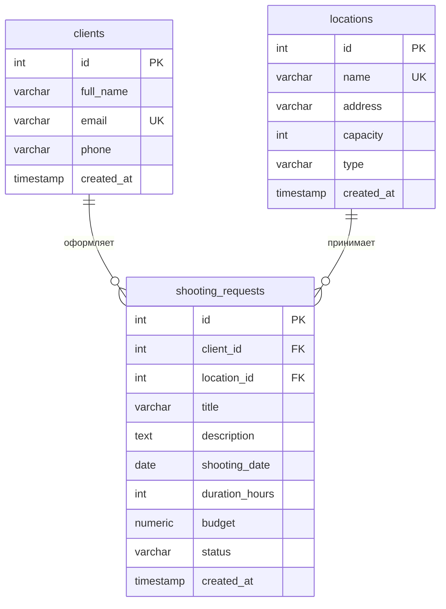

# Материалы к защите: киностудия, заявки на съёмку

Документ собран для устной защиты. Сначала идёт связный текст выступления. Затем разбирается бизнес-логика и каждый файл проекта так, чтобы любое место в исходниках можно было объяснить и обосновать. В конце — ответы на вопросы по схеме базы, нормальной форме, исключениям, проверке ввода, архитектуре и JDBC, а также короткие фрагменты, которые нужно уметь написать в блокноте по ООП, интерфейсам и JDBC.

Запуск программы описан в `README.md`.

## 1. Текст выступления

Работа представляет консольную информационную систему учёта заявок на съёмку киностудии. Заказчик связан с площадкой, датой, длительностью и бюджетом. Студия проводит заявку по согласованной цепочке статусов: от новой записи к согласованию, съёмке и завершению либо к отклонению и отмене. Данные хранятся в PostgreSQL. Пользователь работает через меню, которое не завершается после одной операции.

Приложение написано на Java 17 и собирается Maven. Доступ к базе выполняется через JDBC, книга Excel формируется библиотекой Apache POI. Логика распределена по слоям. Меню принимает ввод и показывает результат. Сервис проверяет правила предметной области. Репозиторий исполняет параметризованные запросы. База поддерживает первичные и внешние ключи, `NOT NULL`, `UNIQUE` и `CHECK`. SQL в коде меню отсутствует.

Предметная модель содержит три сущности. `Client` описывает заказчика. `Location` описывает павильон, студию, натурную площадку или офис. `ShootingRequest` связывает клиента и локацию и является основной сущностью. Связь в обоих случаях «один ко многим». Поле `client_id` ссылается на `clients.id` с каскадным удалением заявок вместе с клиентом. Поле `location_id` ссылается на `locations.id` с запретом удалить локацию, пока на неё есть заявки. Длительность хранится в часах и характеризует объём съёмки. Отдельного расписания по часовым слотам в этой версии нет: система ведёт реестр заявок, а не календарь занятости площадки.

Инкапсуляция выражена закрытыми полями. Состояние объекта доступно через методы. Новая заявка в конструкторе получает статус `NEW`, поэтому её нельзя создать уже завершённой. Деньги представлены типом `BigDecimal`, дата съёмки — `LocalDate`. Перечисления `RequestStatus` и `LocationType` фиксируют замкнутый набор значений. Метод `fromString` переводит ввод пользователя в константу и сообщает об ошибке, если строка не входит в набор.

Полиморфизм опирается на обобщённый интерфейс `Repository<T>`. Контракт один: сохранить, найти по идентификатору, получить список, изменить, удалить. Его реализуют три класса репозиториев. `Optional` в `findById` означает, что строки может не быть. Решение превратить пустой результат в ошибку «запись не найдена» принимает сервис.

Соединение с базой выдаёт `DatabaseManager`. Каждая операция открывает `Connection` и закрывает его вместе с `PreparedStatement` и `ResultSet` конструкцией try-with-resources. В текст запроса подставляются знаки `?`, значения передаются методами `setInt`, `setString`, `setDate` и `setBigDecimal`. Поэтому введённая строка остаётся данными и не становится частью команды SQL. Вставка возвращает присвоенный базой идентификатор через `RETURNING`.

Правила проверяются до записи. Заявка отвергается при пустом названии или описании, при ссылке на отсутствующего клиента или локацию, при дате в прошлом, при нулевой длительности и при отрицательном бюджете. Граф статусов задан в коде: из `NEW` допустимы `APPROVED` и `REJECTED`, из `APPROVED` — `IN_PROGRESS` и `CANCELLED`, из `IN_PROGRESS` — `COMPLETED` и `CANCELLED`. Из `COMPLETED`, `REJECTED` и `CANCELLED` переходы запрещены. Смена статуса доступна в меню заявок, пункт 6. Локацию с активными заявками удалить нельзя. У клиента обязательны ФИО, телефон и почта, содержащая символ `@`.

Нарушение правила порождает `BusinessException`, отсутствие записи — `EntityNotFoundException`. Оба исключения проверяемые: компилятор требует их обработать. Сбой SQL остаётся `SQLException`. В консоль выводится `e.getMessage()`, то есть текст для пользователя, без имени класса и без трассы стека.

Поиск выполняется двумя способами: по фрагменту названия заявки и по названию локации через соединение таблиц. Сравнение без учёта регистра сделано в Java, потому что при локали базы `C` оператор `ILIKE` не уравнивает регистр кириллицы. Фильтрация идёт по статусу и по диапазону дат, сортировка — по дате съёмки и по бюджету. Статистика считает заявки по каждому статусу, суммарный бюджет и среднюю длительность, а также число клиентов и локаций. Экспорт создаёт файл `kinostudio_export.xlsx` с тремя листами.

Схема находится в третьей нормальной форме: неключевые столбцы зависят от первичного ключа своей таблицы, а имя клиента в заявку не копируется. Проверка меню подтвердила обработку текста вместо числа, несуществующих идентификаторов, пустых полей, отрицательного бюджета, запрещённых переходов статуса и попытки передать в поиск фрагмент SQL. Таблица клиентов после такой строки осталась на месте.

Система удовлетворяет требованиям контрольной работы и служит основанием для следующих этапов — графического интерфейса, REST-сервиса и мобильного клиента — без смены предметной области.

## 2. Бизнес-логика

Система отвечает на операционный вопрос студии: какая съёмка заказана, кем, где, когда, на сколько часов, за какой бюджет и на каком этапе согласования она находится.

Жизненный цикл заявки зафиксирован в сервисе, а не в тексте меню.

```26:32:src/main/java/ru/mirea/kinostudio/service/ShootingRequestService.java
    static {
        ALLOWED_TRANSITIONS.put(RequestStatus.NEW, EnumSet.of(RequestStatus.APPROVED, RequestStatus.REJECTED));
        ALLOWED_TRANSITIONS.put(RequestStatus.APPROVED, EnumSet.of(RequestStatus.IN_PROGRESS, RequestStatus.CANCELLED));
        ALLOWED_TRANSITIONS.put(RequestStatus.IN_PROGRESS, EnumSet.of(RequestStatus.COMPLETED, RequestStatus.CANCELLED));
        ALLOWED_TRANSITIONS.put(RequestStatus.COMPLETED, EnumSet.noneOf(RequestStatus.class));
        ALLOWED_TRANSITIONS.put(RequestStatus.REJECTED, EnumSet.noneOf(RequestStatus.class));
        ALLOWED_TRANSITIONS.put(RequestStatus.CANCELLED, EnumSet.noneOf(RequestStatus.class));
    }
```

`EnumMap` выбран потому, что ключ — константа перечисления: для каждого статуса ровно одна ячейка. `EnumSet` хранит допустимые следующие статусы компактно и проверяет вхождение методом `contains`. Пустое множество у терминальных статусов означает, что ни один переход не пройдёт.

Общая проверка создания и изменения собрана в одном методе, чтобы правила не разошлись между `create` и `update`.

```143:172:src/main/java/ru/mirea/kinostudio/service/ShootingRequestService.java
        if (title == null || title.isBlank()) {
            throw new BusinessException("Название заявки не может быть пустым.");
        }
        if (description == null || description.isBlank()) {
            throw new BusinessException("Описание заявки не может быть пустым.");
        }
        if (!clientRepository.existsById(clientId)) {
            throw new BusinessException("Клиент с ID=" + clientId + " не существует.");
        }
        if (!locationRepository.existsById(locationId)) {
            throw new BusinessException("Локация с ID=" + locationId + " не существует.");
        }
        if (shootingDate == null || shootingDate.isBefore(LocalDate.now())) {
            throw new BusinessException("Дата съёмки не может быть в прошлом.");
        }
        if (durationHours <= 0) {
            throw new BusinessException("Длительность съёмки должна быть больше нуля.");
        }
        if (budget == null || budget.compareTo(BigDecimal.ZERO) < 0) {
            throw new BusinessException("Бюджет не может быть отрицательным.");
        }
```

Порядок проверок обоснован. Сначала проверяются собственные поля заявки, затем существование связанных записей, затем календарное и числовое ограничение. `isBlank` отклоняет и `null`, и строку из пробелов. `compareTo` для `BigDecimal` используется потому, что операторы `<` и `>` к этому типу неприменимы. Существование клиента и локации проверяется в Java до `INSERT`, чтобы пользователь получил предметное сообщение. Внешний ключ в базе остаётся вторым рубежом: даже при обходе сервиса ссылка на несуществующую строку не сохранится.

Удаление локации дополнительно смотрит активные заявки. База и так запрещает удалить локацию, на которую есть любая заявка (`ON DELETE RESTRICT`). Сервис формулирует более узкое правило: запрет касается заявок в статусах `NEW`, `APPROVED` и `IN_PROGRESS`.

```59:65:src/main/java/ru/mirea/kinostudio/service/LocationService.java
    public void delete(int id) throws EntityNotFoundException, BusinessException, SQLException {
        getById(id);
        if (repository.hasActiveRequests(id)) {
            throw new BusinessException("Нельзя удалить локацию: на неё есть активные заявки на съёмку.");
        }
        repository.deleteById(id);
    }
```

`getById` вызывается до удаления, чтобы несуществующий идентификатор дал «запись не найдена», а не молчаливый успех.

Длительность в часах описывает объём работы. Она не резервирует интервал «с 13:00 до 15:00». Две заявки на одну дату и одну площадку в текущей модели допустимы. Это соответствует заданию контрольной: реестр заявок, статус, фильтры и статистика. Календарь свободных слотов потребовал бы времени начала, времени окончания и запрета пересечений. Такой планировщик можно добавить на следующем этапе, не отменяя уже реализованный учёт.

Статус из модели не убирается. На нём держатся перечисление, граф переходов, фильтр и статистика. Менять его можно из консоли: главное меню, пункт 3, затем пункт 6. Отдельная роль администратора не вводится, потому что в программе нет учётных записей. Консоль и есть рабочее место оператора.

## 3. Разбор исходного кода

### 3.1. Сборка, `pom.xml`

Файл описывает проект для Maven. `groupId` `ru.mirea.kinostudio`, артефакт `kinostudio-crm`, версия `1.0.0`, исходники Java 17, кодировка UTF-8. Зависимость `org.postgresql:postgresql` — драйвер JDBC. Зависимость `poi-ooxml` — запись формата `.xlsx`. Плагин компилятора собирает классы. Плагин shade упаковывает зависимости в один jar `target/kinostudio-crm.jar` и записывает в манифест главный класс `ru.mirea.kinostudio.Main`, чтобы запуск `java -jar` находил метод `main`.

### 3.2. Схема `sql/schema.sql`

Скрипт сначала удаляет таблицы в порядке «заявки, затем клиенты и локации». Дочернюю таблицу нужно убрать раньше родителей, иначе внешний ключ не даст выполнить `DROP`.

`clients`: `id SERIAL PRIMARY KEY` выдаёт номер средствами базы. `email UNIQUE` не позволяет завести двух заказчиков с одной почтой. `NOT NULL` стоит на ФИО, почте и телефоне. `created_at` по умолчанию равен `NOW()`.

`locations`: уникально название. `CHECK (capacity > 0)` и `CHECK (type IN (...))` ограничивают вместимость и тип на уровне базы, независимо от Java.

`shooting_requests`: два внешних ключа, `CHECK` на длительность, бюджет и список статусов. Индексы по статусу, дате и локации ускоряют фильтры, которые заданы в задании. В скрипте пять клиентов, восемь локаций и десять заявок в разных статусах, чтобы поиск, фильтр и сортировку можно было показать без ручного ввода.

Тестовые даты в прошлом вставлены самим SQL. Правило «дата не в прошлом» действует в сервисе при создании через меню. Исторические строки для демонстрации завершённых и отменённых заявок загружаются скриптом напрямую.

### 3.3. Модель

Пакет `model` хранит данные в памяти после чтения из базы или перед записью. Поля у всех классов объявлены `private`. Это инкапсуляция: внешний код не меняет поля в обход методов, а формат `toString` можно изменить, не трогая репозиторий.

`Client` содержит идентификатор, ФИО, почту, телефон и время создания. Три конструктора нужны по разным поводам. Пустой конструктор оставляет объект для сборки по частям. Конструктор из трёх строк создаёт клиента до вставки, когда идентификатор ещё неизвестен. Полный конструктор собирает объект из строки `ResultSet`, где идентификатор и время уже есть.

`Location` добавляет адрес, вместимость и `LocationType`. Тип объявлен перечислением, поэтому в поле нельзя положить произвольную строку на этапе компиляции. В базе тип всё равно хранится текстом: JDBC не передаёт Java-enum напрямую, репозиторий вызывает `type.name()` при записи и `LocationType.fromString` при чтении.

`ShootingRequest` хранит оба внешних ключа числами `clientId` и `locationId`, а не вложенными объектами. Так репозиторий записывает ровно те столбцы, которые есть в таблице, без дополнительной загрузки клиента и локации на каждую заявку. Конструктор новой заявки сам ставит `RequestStatus.NEW`.

```25:35:src/main/java/ru/mirea/kinostudio/model/ShootingRequest.java
    public ShootingRequest(int clientId, int locationId, String title, String description,
                            LocalDate shootingDate, int durationHours, BigDecimal budget) {
        this.clientId = clientId;
        this.locationId = locationId;
        this.title = title;
        this.description = description;
        this.shootingDate = shootingDate;
        this.durationHours = durationHours;
        this.budget = budget;
        this.status = RequestStatus.NEW;
    }
```

`toString` у всех трёх классов форматирует строку для консоли. Меню печатает объект целиком, отдельный класс представления для КР1 не требуется.

`RequestStatus` и `LocationType` — перечисления. Константа существует в единственном экземпляре, сравнение через `==` корректно. `valueOf` чувствителен к регистру и к лишним пробелам, поэтому `fromString` сначала вызывает `trim().toUpperCase()`. Перехват `IllegalArgumentException` и `NullPointerException` заменяет техническое сообщение JDK на фразу «Некорректный статус» или «Некорректный тип локации».

```6:19:src/main/java/ru/mirea/kinostudio/model/RequestStatus.java
public enum RequestStatus {
    NEW,
    APPROVED,
    IN_PROGRESS,
    COMPLETED,
    REJECTED,
    CANCELLED;

    public static RequestStatus fromString(String value) {
        try {
            return RequestStatus.valueOf(value.trim().toUpperCase());
        } catch (IllegalArgumentException | NullPointerException e) {
            throw new IllegalArgumentException("Некорректный статус: " + value);
        }
    }
}
```

Тот же набор строк продублирован в `CHECK` таблицы. Перечисление защищает Java-код, ограничение базы защищает данные, если строку вставит другой клиент.

### 3.4. Исключения

`BusinessException` и `EntityNotFoundException` наследуют `Exception`, а не `RuntimeException`. Это проверяемые исключения. Метод, который их бросает, обязан написать `throws`, а вызывающий код обязан поймать их или пробросить дальше. Так нарушение правила нельзя случайно проигнорировать.

```6:9:src/main/java/ru/mirea/kinostudio/exception/BusinessException.java
public class BusinessException extends Exception {
    public BusinessException(String message) {
        super(message);
    }
}
```

`super(message)` передаёт текст в стандартное поле исключения. Именно его потом читает `getMessage()`. Два разных класса нужны, чтобы меню могло вывести разные префиксы: «Нарушение бизнес-правила» и «Запись не найдена».

### 3.5. Интерфейс репозитория

```11:17:src/main/java/ru/mirea/kinostudio/repository/Repository.java
public interface Repository<T> {
    T save(T entity) throws SQLException;
    Optional<T> findById(int id) throws SQLException;
    List<T> findAll() throws SQLException;
    void update(T entity) throws SQLException;
    void deleteById(int id) throws SQLException;
}
```

Интерфейс задаёт контракт и не хранит полей. Параметр `T` делает один контракт пригодным и для клиента, и для локации, и для заявки. `throws SQLException` стоит здесь, потому что реализация обязана работать с JDBC, а `SQLException` проверяемое. `Optional` в сигнатуре документирует отсутствие строки без использования `null`.

`ClientRepository`, `LocationRepository` и `ShootingRequestRepository` пишут `implements Repository<...>`. Это полиморфизм: вызывающий код может держать ссылку типа `Repository<Client>` и вызвать `save`, не зная конкретного класса. В `Main` поля объявлены конкретными классами, потому что сервисам нужны дополнительные методы: `existsById`, `hasActiveRequests`, поиск и статистика. Эти методы в общий интерфейс не вынесены, чтобы не заставлять репозиторий клиентов уметь считать бюджет заявок.

### 3.6. JDBC в репозиториях

`DatabaseManager` объявлен `final`, конструктор закрыт. Экземпляр не создаётся, наследование закрыто, доступен только статический `getConnection`. Константы URL, пользователя и пароля собраны в одном месте, чтобы при переносе на другой компьютер менять один файл. Адрес по умолчанию: `jdbc:postgresql://localhost:5432/kinostudio_db`, пользователь `postgres`, пароль `postgres`.

Каркас операции одинаков. Пример вставки клиента:

```16:28:src/main/java/ru/mirea/kinostudio/repository/ClientRepository.java
        String sql = "INSERT INTO clients (full_name, email, phone) VALUES (?, ?, ?) RETURNING id, created_at";
        try (Connection conn = DatabaseManager.getConnection();
             PreparedStatement ps = conn.prepareStatement(sql)) {
            ps.setString(1, c.getFullName());
            ps.setString(2, c.getEmail());
            ps.setString(3, c.getPhone());
            try (ResultSet rs = ps.executeQuery()) {
                if (rs.next()) {
                    c.setId(rs.getInt("id"));
                    c.setCreatedAt(rs.getTimestamp("created_at").toLocalDateTime());
                }
            }
        }
```

Обоснование каждой части:

- `?` отделяет команду от значений. Драйвер передаёт ФИО и почту как данные, даже если в них есть кавычка или фрагмент `DROP TABLE`.
- `RETURNING` — конструкция PostgreSQL. База в том же запросе отдаёт `id` и `created_at`, которые проставило само ограничение `SERIAL` и значение по умолчанию `NOW()`.
- `executeQuery` используется потому, что `RETURNING` возвращает строку. Для `UPDATE` и `DELETE` вызывается `executeUpdate`: результирующего набора там нет.
- try-with-resources закрывает соединение, запрос и набор и при нормальном выходе, и при исключении. Иначе соединения оставались бы открытыми до конца процесса.
- `mapRow` в каждом репозитории переносит столбцы в конструктор модели. Для статуса и типа вызывается `fromString`, чтобы в объекте снова было перечисление, а не строка.

`existsById` выполняет `SELECT 1 ... WHERE id = ?` и возвращает `rs.next()`. Достаточно факта наличия строки, читать все столбцы незачем.

`LocationRepository.hasActiveRequests` ищет заявку этой локации, чей статус не входит в `COMPLETED`, `REJECTED`, `CANCELLED`. `LIMIT 1` останавливает поиск на первой подходящей строке.

`ShootingRequestRepository` повторяет тот же каркас для восьми столбцов заявки. Дата передаётся как `Date.valueOf(localDate)`, бюджет — как `setBigDecimal`, статус — как `status.name()`.

Поиск по названию загружает заявки и отбирает их потоком. Сравнение `toLowerCase(Locale.ROOT)` уравнивает регистр кириллицы. Поиск по локации выполняет `JOIN locations` и то же сравнение по столбцу `l.name`. Так сохраняется требуемое соединение таблиц, а регистр не зависит от локали сервера.

Фильтр по статусу и фильтр по диапазону дат остаются обычными запросами с `?`. Сортировка собрана в приватном методе:

```170:172:src/main/java/ru/mirea/kinostudio/repository/ShootingRequestRepository.java
    private List<ShootingRequest> findAllSortedBy(String column) throws SQLException {
        List<ShootingRequest> result = new ArrayList<>();
        String sql = "SELECT * FROM shooting_requests ORDER BY " + column;
```

Имя столбца нельзя передать через `?`: подготовленный параметр подставляет значение, а не идентификатор. В метод попадают только литералы `shooting_date` и `budget` из `findAllSortedByDate` и `findAllSortedByBudget`. Текст с клавиатуры сюда не приходит.

Статистика считает `COUNT(*)`, `COUNT` по статусу, `COALESCE(SUM(budget), 0)` и `COALESCE(AVG(duration_hours), 0)`. `COALESCE` нужен, чтобы пустая таблица вернула ноль, а не `NULL`.

### 3.7. Сервисы

`ClientService.create` отклоняет пустое ФИО, пустой телефон и почту без `@`, затем вызывает `repository.save(new Client(...))`. `getById` раскрывает `Optional` через `orElseThrow` в `EntityNotFoundException`. `update` сначала загружает существующую строку, меняет поля и вызывает `update`. `delete` тоже начинает с `getById`.

`LocationService` проверяет название, адрес и положительную вместимость. Удаление описано выше.

`ShootingRequestService` получает три репозитория в конструкторе. Свой нужен для записи заявки, репозиторий клиентов и репозиторий локаций — для проверки внешних ключей. Создание идёт так: `validateCommon`, затем `new ShootingRequest(...)`, затем `save`. Изменение загружает заявку, повторяет ту же проверку и сохраняет поля, не трогая статус. Статус меняет только `changeStatus`, чтобы обычное редактирование карточки не обходило граф переходов.

`filterByDateRange` отклоняет диапазон, у которого начало позже конца. `getStatistics` складывает показатели в `LinkedHashMap`: этот вид карты сохраняет порядок вставки, и на экране строки идут в задуманной последовательности.

### 3.8. Меню, ввод и экспорт

`Main` создаёт один `Scanner` и по одному репозиторию и сервису на сущность. Цикл `while (running)` печатает меню, читает номер и вызывает соответствующий метод. Ноль присваивает `running = false`. Неизвестный номер сообщает об ошибке и возвращает меню. `SQLException`, вышедшее из любого пункта, перехватывается в этом цикле.

Подменю клиента, локации и заявки выполняет одно действие и возвращается в главное меню. Исключения правил и отсутствия записи ловятся внутри подменю, рядом с операцией, которой они относятся.

`ConsoleUtils` тоже `final` с закрытым конструктором: это набор процедур, а не объект предметной области. `readInt` крутится, пока `Integer.parseInt` не разберёт строку. `readBigDecimal` заменяет запятую на точку, чтобы принять и `15000,50`, и `15000.50`. `readDate` требует `гггг-мм-дд` и при ошибке показывает пример.

```21:30:src/main/java/ru/mirea/kinostudio/util/ConsoleUtils.java
    public static int readInt(Scanner scanner, String prompt) {
        while (true) {
            System.out.print(prompt);
            String input = scanner.nextLine().trim();
            try {
                return Integer.parseInt(input);
            } catch (NumberFormatException e) {
                System.out.println("Ошибка: значение должно быть целым числом. Повторите ввод.");
            }
        }
    }
```

`NumberFormatException` непроверяемое, его можно поймать локально и повторить ввод, не объявляя `throws` у всего меню.

Список таблиц и две итоговые строки статистики печатаются одним вызовом `println`. Строки соединены оператором `+`, перенос задан символом `\n`.

```395:399:src/main/java/ru/mirea/kinostudio/Main.java
    private static void printTables() {
        System.out.println("Таблицы базы данных:\n"
                + " - clients (клиенты)\n"
                + " - locations (локации: павильоны и площадки)\n"
                + " - shooting_requests (заявки на съёмку)");
    }
```

Пункт «Вывести таблицы» показывает известные имена. Он не запрашивает `information_schema`: состав базы для этой работы фиксирован скриптом.

`ExcelExporter` создаёт `XSSFWorkbook`, три листа и строку заголовков с полужирным шрифтом. Цикл по списку заполняет ячейки полями объектов. `autoSizeColumn` подбирает ширину. `FileOutputStream` пишет `kinostudio_export.xlsx` и закрывается через try-with-resources. Класс тоже закрыт для создания экземпляров: экспорт — одна статическая операция.

Коллекции в проекте используются по назначению. `ArrayList` накапливает строки выборки. `List` стоит в сигнатурах, чтобы вызывающий код не зависел от конкретной реализации списка. `Optional` выражает отсутствие объекта. `LinkedHashMap` сохраняет порядок статистики. `EnumMap` и `EnumSet` описывают граф статусов. Stream API отбирает заявки при поиске по названию.

## 4. Ответы на вопросы по схеме, ошибкам и SQL

### ER-диаграмма



`clients.id` — первичный ключ, на него ссылается `shooting_requests.client_id`. При удалении клиента заявки удаляются каскадом. `locations.id` — первичный ключ, на него ссылается `shooting_requests.location_id`. Удалить локацию, пока есть ссылки, база не позволит. Почта клиента и название локации уникальны. Та же диаграмма в русских подписях лежит в `docs/er-diagram.md`.

### Третья нормальная форма

Первая форма выполнена: в ячейке одно значение, повторяющихся групп столбцов нет.

Вторая форма выполнена: первичный ключ каждой таблицы — одиночный столбец `id`. Неключевой атрибут не может зависеть от части составного ключа, потому что составного ключа нет.

Третья форма выполнена: неключевой столбец зависит от ключа своей таблицы и не зависит от другого неключевого столбца. ФИО, почта и телефон зависят от `clients.id`. Название, адрес, вместимость и тип зависят от `locations.id`. Название заявки, описание, дата, длительность, бюджет и статус зависят от `shooting_requests.id`. Имя и почта клиента в таблицу заявок не копируются: там хранится `client_id`. Если бы в заявке лежали и номер клиента, и его почта, почта зависела бы от клиента, а не от заявки. Это транзитивная зависимость, схема вышла бы из третьей формы.

### `e.getMessage()` и печать объекта `e`

`getMessage()` возвращает текст, переданный в конструктор. Для нашего исключения это фраза «Клиент с ID=99999 не найден».

Печать объекта `e` вызывает `toString()`. Для такого исключения строка начинается с полного имени класса и затем содержит тот же текст. У `SQLException` в `toString()` попадают класс драйвера и служебные коды. Пользователю меню нужен смысл ошибки, поэтому обработчики печатают `e.getMessage()`. Трассу вызовов печатает только `printStackTrace()`. Программа её не вызывает.

В главном цикле это выглядит так:

```57:59:src/main/java/ru/mirea/kinostudio/Main.java
            } catch (SQLException e) {
                System.out.println("Ошибка базы данных: " + e.getMessage());
            }
```

### Проверка неверного ввода

Программа после сборки была прогнана сценарием меню. Сеанс не прервался. Ответы:

| Ввод | Сообщение |
|---|---|
| Пункт меню `9` | Неизвестный пункт меню. |
| Идентификатор `abc` | Значение должно быть целым числом. Запрос повторяется. |
| Клиент `99999`, заявка `99999` | Запись не найдена. |
| Пустое ФИО | ФИО клиента не может быть пустым. |
| Почта без `@` | Некорректный email клиента. |
| Локация `99999` при создании заявки | Локация не существует. |
| Длительность `0` | Длительность должна быть больше нуля. |
| Бюджет `-5` | Бюджет не может быть отрицательным. |
| Статус `COMPLETED` → `APPROVED` | Недопустимый переход статуса. |
| В поле статуса строка `DROP TABLE` | Некорректный статус. |
| Поиск по `'; DROP TABLE clients; --` | Заявки не найдены. В `clients` осталось 5 строк. |

Дополнительно ранее проверялись пустое название заявки, дата в прошлом, отсутствующий клиент, запрет удалить павильон с активными заявками, переход `NEW` → `APPROVED`, отказ `NEW` → `COMPLETED`, поиск «клип» и «павильон», фильтр по `NEW`, диапазон дат, обе сортировки, статистика (10 заявок, бюджет 3 400 000, средняя длительность 9,1 ч) и создание `kinostudio_export.xlsx` с тремя листами.

### Склейка нескольких `println`

Замечание учтено. Имена таблиц и строки «всего клиентов» и «всего локаций» выводятся одним `System.out.println`. Части соединены `+`, перевод строки записан как `\n`. Меню и раньше печатались одним текстовым блоком.

### Архитектура

Поток данных односторонний.

```
Консольное меню → сервис → репозиторий JDBC → PostgreSQL
```

Меню не содержит SQL и не проверяет граф статусов. Сервис не открывает соединение. Репозиторий не решает, допустим ли переход `NEW` → `COMPLETED`. База хранит строки и не пускает значение, нарушившее `CHECK` или внешний ключ. Такое разделение позволяет заменить консоль на JavaFX или REST, оставив сервисы и репозитории.

### `PreparedStatement` и инъекции

Все запросы трёх репозиториев создаются через `connection.prepareStatement`. Класс `Statement` в проекте не используется. Значения с клавиатуры связываются методами `setString`, `setInt`, `setDate` и `setBigDecimal`. Строка поиска с фрагментом `DROP TABLE` была обработана как обычный текст и таблицу не удалила.

Единственная конкатенация внутрь SQL — имя столбца сортировки, и оно выбирается кодом программы из двух констант. Пользовательский ввод в эту позицию не попадает.

## 5. Что писать в блокноте

Писать стоит короткий законченный фрагмент и сразу называть назначение каждой строки. Ниже три заготовки по темам, которые просят воспроизвести самостоятельно. Имена совпадают с проектом, чтобы объяснение стыковалось с защитой.

### Интерфейсы и полиморфизм

Интерфейс объявляет методы без тела и без полей. Класс, который его реализует, обязан определить каждый метод. Переменная типа интерфейса может ссылаться на любой такой класс. Вызов `save` выполнит код того объекта, который реально создан оператором `new`.

```java
public interface Repository<T> {
    T save(T entity) throws java.sql.SQLException;
}

public class ClientRepository implements Repository<Client> {
    @Override
    public Client save(Client client) throws java.sql.SQLException {
        String sql = "INSERT INTO clients (full_name, email, phone) VALUES (?, ?, ?)";
        try (java.sql.Connection conn = DatabaseManager.getConnection();
             java.sql.PreparedStatement ps = conn.prepareStatement(sql)) {
            ps.setString(1, client.getFullName());
            ps.setString(2, client.getEmail());
            ps.setString(3, client.getPhone());
            ps.executeUpdate();
        }
        return client;
    }
}
```

`@Override` просит компилятор проверить, что метод действительно перекрывает метод интерфейса. Ошибка в имени будет видна при сборке. `Repository<Client>` и `Repository<ShootingRequest>` имеют одинаковые операции и разные типы сущностей. Это и есть смысл параметра `T`.

### JDBC

Нужно показать соединение, подготовленный запрос, подстановку параметра, чтение `ResultSet` и закрытие ресурсов.

```java
public Client findById(int id) throws java.sql.SQLException {
    String sql = "SELECT id, full_name, email, phone FROM clients WHERE id = ?";
    try (java.sql.Connection conn = DatabaseManager.getConnection();
         java.sql.PreparedStatement ps = conn.prepareStatement(sql)) {
        ps.setInt(1, id);
        try (java.sql.ResultSet rs = ps.executeQuery()) {
            if (rs.next()) {
                return new Client(
                        rs.getInt("id"),
                        rs.getString("full_name"),
                        rs.getString("email"),
                        rs.getString("phone"),
                        null);
            }
        }
    }
    return null;
}
```

`PreparedStatement` передаёт текст команды отдельно от значения `id`. `Statement` отправил бы уже склеенную строку. Если идентификатор или почта пришли от пользователя, склейка позволила бы дописать к запросу чужую команду. Параметр `?` такой возможности не даёт. `executeQuery` возвращает набор для `SELECT`. `executeUpdate` применяется к вставке, изменению и удалению без возвращаемых строк. Скобки `try (...)` закрывают соединение даже при ошибке.

В проекте отсутствие строки выражено через `Optional.empty()`, а не через `null`. В блокноте допустим и `Optional`, если успеваете его объявить.

### ООП

Нужно показать закрытое поле, конструктор с правилом и метод чтения.

```java
public class ShootingRequest {
    private String title;
    private RequestStatus status;

    public ShootingRequest(String title) {
        if (title == null || title.isBlank()) {
            throw new IllegalArgumentException("Название не может быть пустым");
        }
        this.title = title;
        this.status = RequestStatus.NEW;
    }

    public String getTitle() {
        return title;
    }

    public RequestStatus getStatus() {
        return status;
    }
}
```

Поле `title` снаружи не прочитать и не заменить без метода. Конструктор не допускает пустое название и сразу ставит статус `NEW`. Вызывающий код получает уже согласованный объект. В полной программе такое же правило дополнительно стоит в сервисе, потому что объект могут собрать и другим конструктором при чтении из базы.

Перечисление, которое просят рядом:

```java
public enum RequestStatus {
    NEW, APPROVED, IN_PROGRESS, COMPLETED, REJECTED, CANCELLED
}
```

Если попросят собственное исключение, достаточно класса с одним конструктором:

```java
public class BusinessException extends Exception {
    public BusinessException(String message) {
        super(message);
    }
}
```

Порядок на чистом листе: пакет и класс, поля `private`, конструктор, один метод с проверкой, интерфейс `Repository` с `save` и `findById`, реализация с `PreparedStatement` и `?`. Этого достаточно, чтобы показать инкапсуляцию, интерфейс, полиморфизм и JDBC на материале этой же системы.

## 6. Как показать программу на защите

1. Запустить `java -jar target/kinostudio-crm.jar`.
2. Показать клиентов и локации, затем список заявок.
3. Создать заявку на существующего клиента и локацию с датой в будущем.
4. Ввести `abc` вместо идентификатора и идентификатор `99999`.
5. Попробовать пустое название, дату в прошлом и отрицательный бюджет.
6. Открыть пункт 6 меню заявок и показать запрещённый переход, затем разрешённый `NEW` → `APPROVED`.
7. Найти заявку по фрагменту названия в другом регистре, отфильтровать по `NEW`, отсортировать по бюджету.
8. Открыть статистику и экспорт. Файл появится в каталоге, из которого запущена программа.
9. Выйти пунктом 0.
