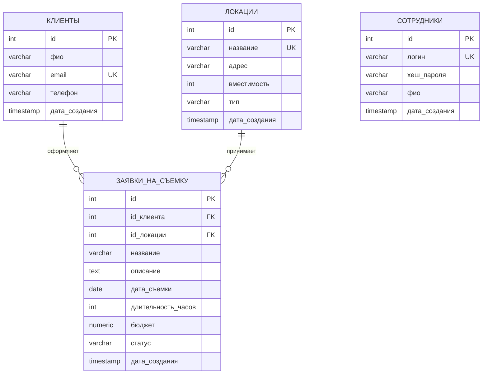

# ER-диаграмма БД «Киностудия — Заявки на съёмку»



> Названия сущностей и полей на диаграмме даны на русском для читаемости.
> Реальные имена таблиц/колонок в БД остаются латиницей (см. `sql/schema.sql`):
> `КЛИЕНТЫ` → `clients`, `ЛОКАЦИИ` → `locations`, `ЗАЯВКИ_НА_СЪЕМКУ` → `shooting_requests`, `СОТРУДНИКИ` → `users`.

## Связи
- `shooting_requests.client_id` → `clients.id` (внешний ключ, `ON DELETE CASCADE`). Один клиент — много заявок (1:N).
- `shooting_requests.location_id` → `locations.id` (внешний ключ, `ON DELETE RESTRICT`, чтобы нельзя было удалить локацию, на которую есть активные заявки). Одна локация — много заявок (1:N).
- `users` не ссылается на `clients`. Сотрудник API и заказчик съёмки — разные сущности. Пароль хранится только как bcrypt-хеш в `password_hash`. Определение таблицы — `sql/users.sql`, в `sql/schema.sql` его нет.

## Сущность «Локации»
Хранит павильоны и натурные площадки студии:
- `название` (`name`) — название площадки (например, «Павильон №1»), уникально.
- `адрес` (`address`) — физический адрес.
- `вместимость` (`capacity`) — вместимость (кв. м или человек).
- `тип` (`type`) — тип локации (`PAVILION` / `OUTDOOR` / `STUDIO` / `OFFICE`, хранится как varchar).

## Ограничения
- `clients.email` — уникален (`UNIQUE`).
- `shooting_requests.duration_hours > 0` (`CHECK`).
- `shooting_requests.budget >= 0` (`CHECK`).
- `shooting_requests.status` — ограничен допустимыми значениями enum (`CHECK ... IN (...)`).

## Граф допустимых переходов статуса заявки
```
NEW ──▶ APPROVED ──▶ IN_PROGRESS ──▶ COMPLETED
 │            │
 └──▶ REJECTED └──▶ CANCELLED
```
Из терминальных статусов (`COMPLETED`, `REJECTED`, `CANCELLED`) переходы запрещены.
