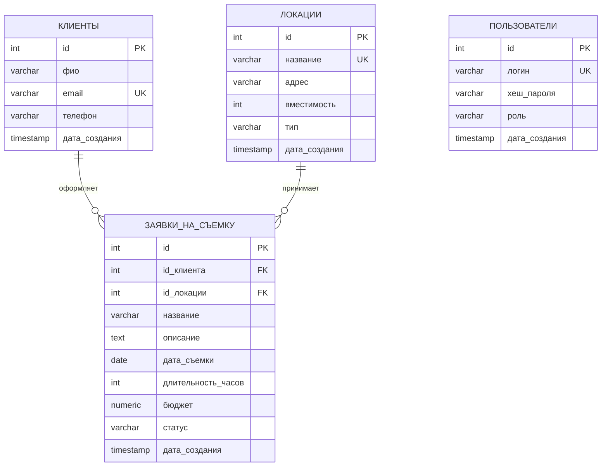
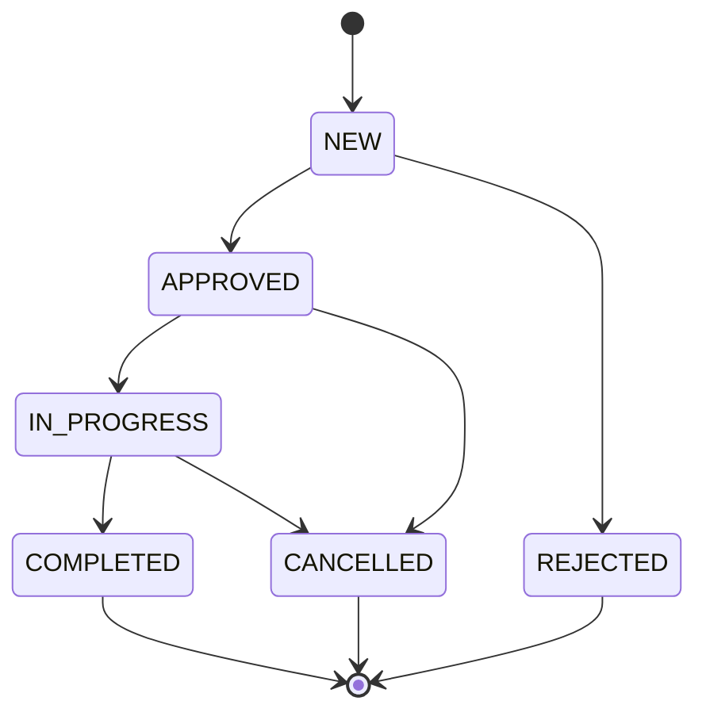

# ER-диаграмма БД «Киностудия — Заявки на съёмку»

> Названия сущностей и полей на диаграмме даны на русском для читаемости.
> Реальные имена таблиц и колонок в БД остаются латиницей (см. `sql/schema.sql` и `sql/users.sql`):
> `КЛИЕНТЫ` → `clients`, `ЛОКАЦИИ` → `locations`, `ЗАЯВКИ_НА_СЪЕМКУ` → `shooting_requests`, `ПОЛЬЗОВАТЕЛИ` → `users`.

## Связи
- `shooting_requests.client_id` → `clients.id` (внешний ключ, `ON DELETE CASCADE`). Один клиент — много заявок (1:N).
- `shooting_requests.location_id` → `locations.id` (внешний ключ, `ON DELETE RESTRICT`, чтобы нельзя было удалить локацию, на которую есть активные заявки). Одна локация — много заявок (1:N).
- Таблица `users` ни с одной таблицей не связана: она относится только к входу в систему и не участвует в учёте заявок.

## Сущность «Локации»
Хранит павильоны и натурные площадки студии:
- `название` (`name`) — название площадки (например, «Павильон №1»), уникально.
- `адрес` (`address`) — физический адрес.
- `вместимость` (`capacity`) — вместимость (кв. м или человек).
- `тип` (`type`) — тип локации (`PAVILION` / `OUTDOOR` / `STUDIO` / `OFFICE`, хранится как varchar).

## Сущность «Пользователи» (КР №2)
Хранит учётные записи обычных пользователей, которые регистрируются в приложении:
- `логин` (`login`) — от 3 до 30 символов, уникален без учёта регистра (уникальный индекс по `LOWER(login)`).
- `хеш_пароля` (`password_hash`) — хеш PBKDF2WithHmacSHA256 в формате `итерации:соль:хеш`, сам пароль не хранится.
- `роль` (`role`) — `USER` или `ADMIN` (ограничение `CHECK`).
- Администратор в таблице не хранится: его логин и пароль задаются в файле `.env` (`ADMIN_LOGIN`, `ADMIN_PASSWORD`).

## Ограничения
- `clients.email` — уникален (`UNIQUE`).
- `shooting_requests.duration_hours > 0` (`CHECK`).
- `shooting_requests.budget >= 0` (`CHECK`).
- `shooting_requests.status` — ограничен допустимыми значениями enum (`CHECK ... IN (...)`).
- `users.role IN ('USER', 'ADMIN')` (`CHECK`).

## Граф допустимых переходов статуса заявки

| Из статуса | Можно перейти в |
|---|---|
| `NEW` | `APPROVED`, `REJECTED` |
| `APPROVED` | `IN_PROGRESS`, `CANCELLED` |
| `IN_PROGRESS` | `COMPLETED`, `CANCELLED` |
| `COMPLETED`, `REJECTED`, `CANCELLED` | никуда (терминальные) |

Правило реализовано в `ShootingRequestService` (`ALLOWED_TRANSITIONS`, метод `changeStatus`).